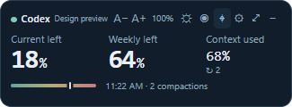
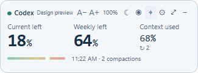

# Token Tracker

October 30 status: [incidents, challenges and handoff](docs/STATUS-AND-HANDOFF.md). Normal-launch Codex discovery is corrected, stale model percentages are withheld and compact history says OLD / OFFLINE. Recurring bridge lifecycle failure remains unresolved; live delivery and passed checks do not certify sustained reliability. Native Windows discovery now precedes PATH fallback.

**Know how much AI usage remains, and leave enough room to finish well.**

A local Windows desktop companion for current-window and weekly AI usage allowances. A movable bubble lives above the taskbar, minimises to the system tray, and opens a dashboard for session context, compactions, activity and continuation records.



The default bubble is now a **compact 260 × 96 strip**, with larger remaining-usage figures and smaller secondary text. Adjust size, opacity, theme, visibility and always-on-top directly from the window. Settings offers explicit always-visible / updates-only / floating-icon / tray-only modes, plus content visibility and planning thresholds. See [desktop controls](docs/DESKTOP-CONTROLS.md).



## What works in this version

- **Codex quota refresh:** independently queries the signed-in Codex account API every minute, even while the model is idle. Local records supply session context/activity. No provider credentials are read.
- **Independent collection:** no AI tokens used for monitoring, persistence, the clock, alerts or display.
- **Quota-first interface:** current-window and weekly percentages; accounts shared across chats remain separate from per-session context.
- **Desktop lifecycle:** movable/pinned bubble, close/minimise to tray, tray restore, separate dashboard and explicit Quit.
- **Context awareness:** occupancy, observed compactions and an explained continuity-risk scale. This is not a measured performance score.
- **Local history:** SQLite metadata, incremental log cursors and duplicate-event protection; checkpoints and background-job notes.
- **Claude integration:** optional reversible statusline + lifecycle-hook installer. Preserves the existing statusline and backs up settings. Requires Node on PATH.
- **Model access:** local CLI, copyable briefings and an optional read-only MCP tool. Trusted Codex lifecycle hooks and optional Claude prompt/start hooks inject brief awareness updates.
- **Correct exhausted-state display:** current 0% and weekly remaining allowance stay independent. Empty metadata buckets do not produce duplicate usage cards. Stale figures are retained and labelled.
- **Usage/reset alarms:** persisted warning/exhaustion/reset/availability history, configurable sounds and volume, and a speaker-test button. See [quota and alerts](docs/QUOTA-AND-ALERTS.md).

## Important capability boundaries

This is an early working desktop application, not a universal guarantee against abrupt session termination.

| Capability | Status |
|---|---|
| Codex Desktop local usage observation | Connected and tested against local records |
| Current and weekly token counts | Providers may report only percentages; exact remaining tokens are unavailable when not supplied |
| Automatic Codex awareness | Live hook delivery verified in the owner development chat; each installation must trust the exact definitions |
| Claude statusline and prompt/start delivery | Implemented; synthetic integration tested, owner installation/live acceptance still required |
| Claude stop/tool completion events | Observed by hooks; do not force another model turn |
| Fully automatic verified handoff | Not implemented; save manual checkpoints/job records or have the AI use the briefing |
| Time-to-exhaustion forecast | Not shown; reliable allowance history and calibration needed |
| Other AI clients | Adapter work required |

Codex session discovery reads up to 100 recently modified files in the last seven calendar days. Older sessions outside that range are not automatically followed. Initial reads use recent tails, so compaction counts are **observed**, potentially incomplete. Account quotas also refresh independently through the Codex executable on PATH (`TOKEN_TRACKER_CODEX_BINARY` can select an explicit executable). Last known figures remain visible when stale or a reset is due, with clear labels; the app never assumes a refill.

## Run from source

Requires Windows and Node.js 24.14+ (built-in SQLite). Electron supplies its own runtime for the desktop application.

```powershell
npm ci
npm test
npm start
```

Close or minimise either window to keep monitoring in the tray. Use **Quit Token Tracker** in the tray menu to stop it. Launch-on-login is not enabled. Default display timezone is `Africa/Johannesburg`, editable in Integrations.

Build a local desktop folder:

```powershell
npm run pack
& '.\dist\win-unpacked\Token Tracker.exe'
```

The local build is unsigned. No binary release or installer is published by this source repository.

## Connect Claude Code

Open Dashboard → Integrations → **Connect Claude Code**. This deliberately changes your Claude settings only after that action. Restart Claude Code. The companion must be running for delivery.

The integration records metadata on prompt, tool, compaction and completion events. On prompt/session start it returns a short awareness update using `additionalContext`. Stop events are recorded without returning feedback that could restart the model. Existing statusline output is preserved. Remove the integration with the same button; unrelated settings edits are retained.

## Connect Codex model updates

Dashboard → Integrations → Configure Codex model updates. Review and trust the exact definitions through Codex `/hooks`, then resume the chat. The dashboard shows hook observations and the last client-output receipt separately from quota observation. The helper is stored under `%APPDATA%\TokenTracker\bridge\`. No trust bypass is used. Until reviewed hooks actually run, automatic model warnings are not verified.

Normal dashboards contain only real readings. Design fixtures are available exclusively through explicit developer capture routes, not a user-facing preview toggle.

## CLI and optional MCP

While the desktop app is running:

```powershell
node src/cli.cjs status
node src/cli.cjs status YOUR_SESSION_ID
```

For an MCP client, use command `node`, arguments `["ABSOLUTE_PATH_TO/src/cli.cjs", "mcp"]`. This exposes one read-only tool, `get_session_awareness`. Collection stays independent; tool descriptions and model-visible responses still have context overhead. Add client configuration yourself; the app does not silently modify Codex settings.

## Data and privacy

Runtime data stays under `%APPDATA%\TokenTracker\`: metadata SQLite database, local bridge descriptor and Claude integration recovery information. The bridge uses a random per-run capability token over a local named pipe. Runtime files, local screenshots, databases, dependencies and builds are excluded from Git.

No cloud account, telemetry, provider keys or message-content storage. User-authored continuation notes can contain whatever the user chooses to save. Do not put secrets in those notes.

## Documentation and verification

- [Product requirements](docs/PRODUCT.md)
- [Architecture](docs/ARCHITECTURE.md)
- [Build plan](docs/BUILD-PLAN.md)
- [Verification and limitations](docs/VERIFICATION.md)
- [Implementation roadmap](docs/ROADMAP.md)
- [Desktop controls and settings](docs/DESKTOP-CONTROLS.md)

```powershell
npm run check
npm test
npm run start -- --smoke
npm run capture
npm audit
```

Smoke/capture modes use isolated data folders under ignored `runtime/`, exercise native window lifecycle, and exit. Capture mode shows explicitly illustrative data; it does not seed the live database.

MIT licensed. Model subscriptions/API usage are separate from this free tool.
